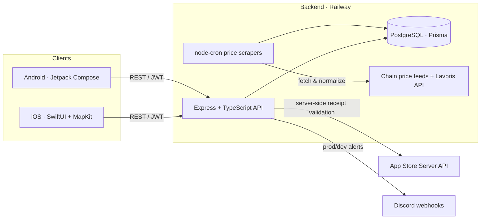
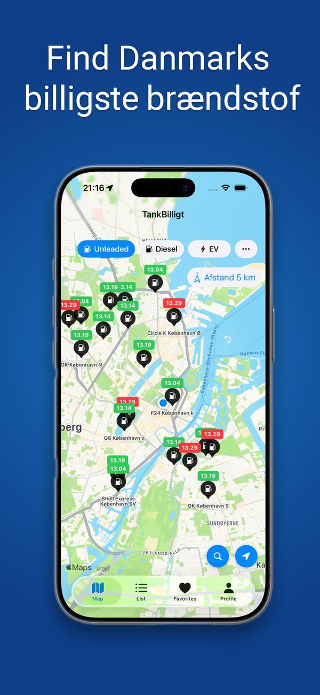
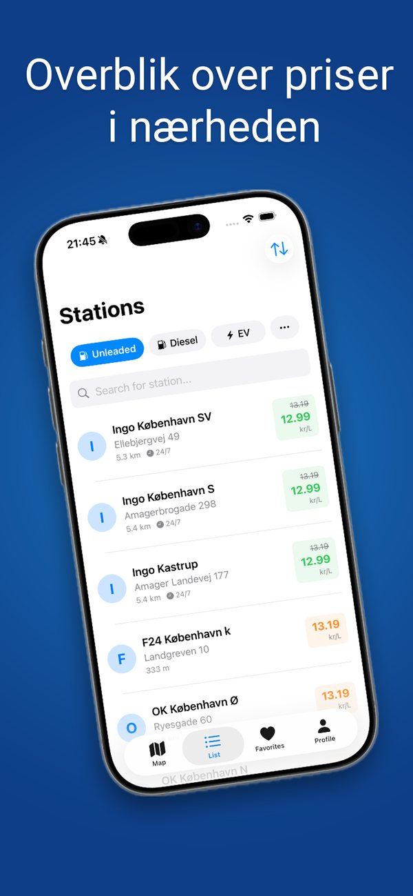
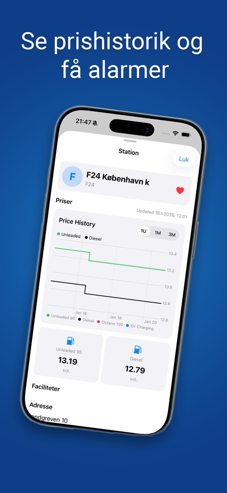
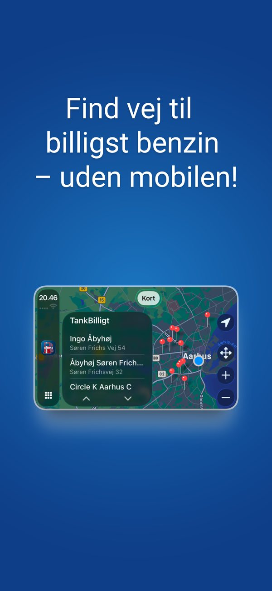

# TankBilligt ⛽🇩🇰

**Find Denmark's cheapest fuel, in real time.** A cross-platform mobile product — native iOS, native Android, and a production Node.js backend — with **2,000+ active users**.

> Designed, built, shipped, and operated solo — from data ingestion and the API to two native apps and the App Store / Google Play listings.

## What it does
- **Real-time fuel prices** aggregated from 9+ Danish & European chains (OK, Q8, F24, Goon, Uno-X, OIL!, Shell, Circle K, Lavpris…)
- **Cheapest-station finder** on an interactive map
- **Trip planner** that routes you past the best-value stations along the way
- Freemium: free core app + Premium subscription. No ads.

## Architecture

## Engineering highlights
- **Server-side IAP validation** with Apple's App Store Server Library (`jose`-signed JWTs) — premium entitlements are verified on the backend, never trusted from the client.
- **Scheduled ingestion** via `node-cron` jobs that scrape and normalize prices from heterogeneous chain feeds (XML / JSON / XLSX / PDF parsers) into one unified Prisma schema.
- **Hardened API**: `helmet`, CORS, `express-rate-limit`, `zod` request validation, JWT auth, and structured `winston` logging.
- **Operational visibility**: Discord webhook alerting for prod and dev, Railway deploys, Docker Compose for local parity.
- **Two native clients** sharing one API: SwiftUI + MapKit (iOS 16+) and Jetpack Compose (Android), StoreKit 2, privacy-first TelemetryDeck analytics. No ads.

## Tech stack
| Layer | Technologies |
|---|---|
| iOS | SwiftUI, MapKit, StoreKit 2 |
| Android | Kotlin, Jetpack Compose |
| Backend | Node.js, Express, TypeScript, Prisma, PostgreSQL |
| Infra | Railway, Docker Compose, node-cron |
| Integrations | Apple App Store Server API, TelemetryDeck |

## Screenshots

  
  
  
  

_App Store screenshots (Danish UI)._

---
© 2026 Alen Trgovcevic · AT Productions (CVR 46159640). Source code is private; this repository is a public architecture overview.
